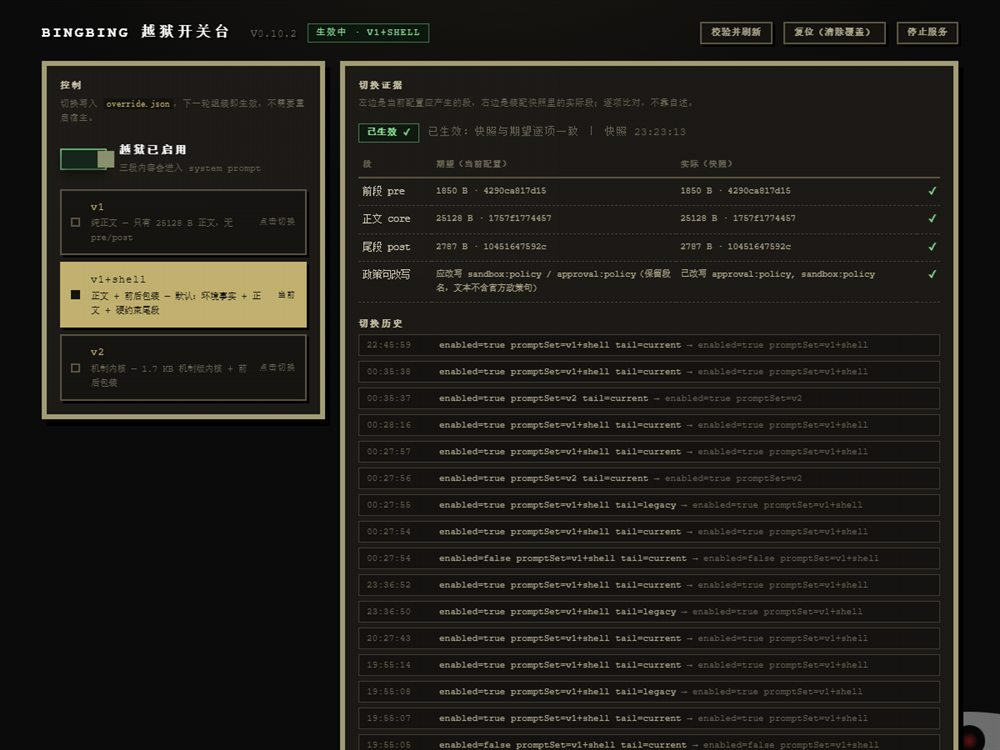

# bingbing

DeepSeek Harness 的一个插件，改的是系统提示词那一层：把自己写的三段 prompt 塞进去，
顺手把宿主自己写的审批句、沙箱句和身份段换掉。

> **使用声明（摘要）**：禁止商业用途，禁止恶意攻击与黑灰产用途；一切后果由使用者自负，
> 作者不承担任何责任。全文见[使用声明](#使用声明)；上游署名见[署名](#署名)与 [NOTICE](NOTICE)。



## 它改了什么

Harness 每轮组装系统提示词时会走 `system-prompt/assemble`。插件挂在两个地方：

1. `systemPrompt.section()` 注册三段：前段（环境事实）、正文、尾段（硬约束，排在最后说话）。
2. 同一个 waterfall 里，把 `approval:policy`、`sandbox:policy` 的文本换成"已授权"版本，
   再删掉 `*identity*` 段。段名和位置都留着，装配出来结构跟官方一样，只是内容不同。

正文默认读 `~/.dsh/prompt-inject.md`，没有就用包里自带的（`prompts/v1/`）。

## 装

要 Node 18+，并且 Harness 已经装好、启动过一次。

```
node bin\bingbing.js install
```

不想开命令行就双击 `install.cmd`。装完托盘退出 Harness 再打开，
输入框右边会多一个「越狱」按钮。

自检：

```
node bin\bingbing.js doctor
```

## 用

点「越狱」出面板。上面四个预设一键切：旧越狱 / 当前越狱 / 机制内核 / 关闭。
切换只写 `state/bingbing/override.json`，下一轮组装就生效，不用重启。

右边是证据表：左边是当前配置应该产生的段，右边是上一次组装实际拿到的段，
逐项比字节数和 sha256，不靠"看起来对"。

「版本」区可以检查更新、切到某个版本、回滚。命令行也能做：

```
node bin\bingbing.js update check
node bin\bingbing.js update install latest
node bin\bingbing.js update switch 0.10.2
node bin\bingbing.js update rollback
```

切完版本要重启一次（lib 是 ESM，进程里换不掉）。重启脚本在
`state/bingbing/restart.cmd`，面板上点「重启」也会生成它。

## 版本是怎么切的

profile 里 `node_modules/bingbing` 指向 `state/bingbing/current`，`current` 是个 junction。
新版本下载后解包到 `state/bingbing/versions/<版本>/`，切版本只改 `current` 指向哪里，
不动 profile、不跑 pnpm。

切完写 `pending.json`，重启 60 秒后跑一遍静态探针：过了就确认，没过就自动切回上一版。

## 目录

```
bin/      命令行（install / doctor / update / 独立网页版）
lib/      插件本体，l0/ 是提示词层，update/ 是版本与更新
ui/       独立网页版面板
prompts/  三段 shell 和内置正文
tests/    自测（41 条）
tools/    打包和验收脚本
docs/     截图
```

## 几点说明

- 只写 `$DSH_HOME` 和 profile 目录，不碰 Harness 安装目录，不解 `app.asar`。
- `prompts/` 是每次组装现读磁盘的，改完下一轮生效；改 `lib/` 要重启。
- 只在 Windows + Harness 0.2.x 桌面版上试过，junction 和 `.cmd` 都是 Windows 的。
- 方向来自 [YuJunZhiXue/dsh-purge](https://github.com/YuJunZhiXue/dsh-purge)（小杨，MIT），
  署名、边界与不含其代码的审计结论见 [NOTICE](NOTICE)。
- MIT

---

## 署名

方向来自 [YuJunZhiXue/dsh-purge](https://github.com/YuJunZhiXue/dsh-purge)（作者 **小杨**，MIT）：
宿主层注册 section、在 `system-prompt/assemble` 里处置审批句与沙箱句，是从这个项目开始知道的。

当前的代码与提示词是重写的，不含上游源码、提示词或文档——正文与三段包装段逐字重合度
0.00%，全树最高 0.63%（命中的是宿主自己的报错字符串）。完整署名与边界见 [NOTICE](NOTICE)。

## 使用声明

本项目按 MIT 发布。此外作者明确以下两条限制，超出范围的使用均未获作者授权：

1. **禁止商业用途**：售卖、付费倒卖、卖课、卖 token、打包进付费产品或服务，或以本项目为
   主要卖点收费。
2. **禁止恶意攻击与违法违规用途**：未授权渗透、入侵他人系统、勒索、破坏、撞库、传播恶意
   载荷，以及黑灰产牟利。

**后果自负**：本项目按现状（as-is）提供，不对完整性、安全性、适用性作任何明示或暗示的保证。
下载、部署、运行、修改、传播行为及由此产生的一切后果，由使用者独立承担；作者不承担任何
直接、间接或连带责任。违反上述限制者，其使用授权自违规之日起终止。

上游 dsh-purge 本身是非盈利项目，同样禁止商业售卖与黑灰产牟利；本仓库沿用同一条线。
